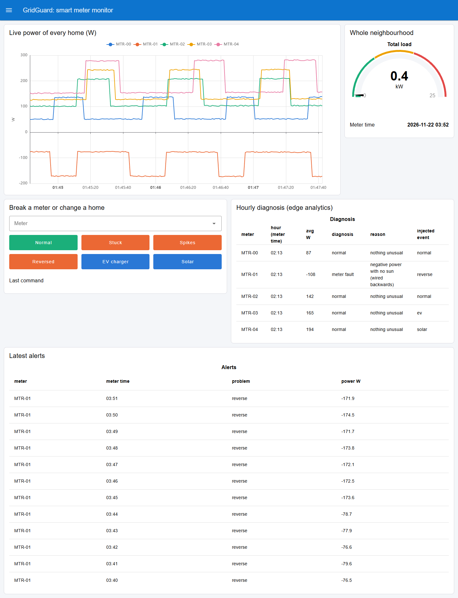
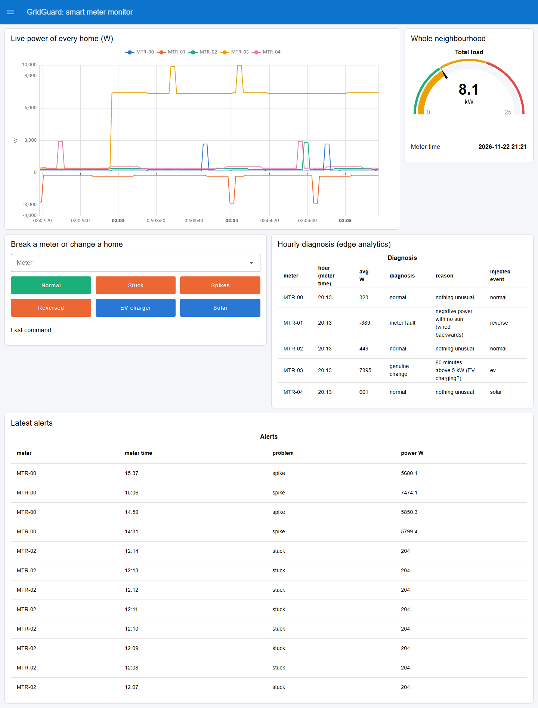

# GridGuard: smart-meter monitoring with Node-RED, MongoDB and ThingSpeak

IoT Analytics Lab mini project, JIIT. Mukul Aggarwal (2401030239) and Shivam Diwaker (2401030245).

Five homes have smart meters. **Node-RED** collects their readings over **MQTT**, checks every reading, stores everything in **MongoDB**, uploads a summary to **ThingSpeak**, and shows a live dashboard. It also decides, every hour, whether a strange meter is **broken** (stuck, spiking, wired backwards) or whether the home **genuinely changed** (an EV, solar panels). That distinction is the core idea of our GridGuard synopsis. **Jupyter notebooks** analyse the stored data and demonstrate the federated-learning part with graphs.

## Architecture

```
                 ┌──────────────────────────── Node-RED (node-red/flows.json) ─────────────────────────────┐
                 │                                                                                         │
 Tab 1           │  5 simulated smart meters ──MQTT──▶ built-in MQTT broker (Aedes, port 1883)               │
 Smart meters    │        ▲                                   │                                            │
                 │        └── commands (gridguard/control/#)  ▼                                            │
 Tab 2           │                                  Check reading ──▶ MongoDB: readings, alerts           │
 Ingest, detect  │                                        └──▶ Hourly diagnosis ──▶ MongoDB: diagnosis     │
 Tab 3           │                                        └──▶ 20 s summary ──HTTP──▶ ThingSpeak channel   │
 Tab 4           │                                        └──▶ Dashboard 2.0 (charts, gauge, buttons)     │
                 └─────────────────────────────────────────────────────────────────────────────────────────┘
                                                   │
                         Jupyter notebooks ◀───────┘  (read MongoDB and ThingSpeak, draw graphs)
```

| Tool | What it does here |
|---|---|
| **Node-RED** | meter simulation, MQTT broker, validation, fault detection, hourly diagnosis, MongoDB writes, ThingSpeak upload, dashboard |
| **MQTT** | how meters send readings and receive commands (`gridguard/meters/<id>/reading`, `gridguard/control/<id>`) |
| **MongoDB** | stores raw readings, alerts and hourly diagnoses (database `gridguard_iot`) |
| **ThingSpeak** | cloud channel with 8 fields: power of each home, total load, alert count, faulty meters |
| **Jupyter (Python)** | analysis and graphs only |

## Folder

| Path | What it is |
|---|---|
| `node-red/flows.json` | the whole IoT application (4 tabs) |
| `node-red/package.json` | Node-RED and the three add-ons it needs |
| `notebooks/1_iot_data_analysis.ipynb` | graphs of the data Node-RED stored in MongoDB (and ThingSpeak) |
| `notebooks/2_gridguard_federated_learning.ipynb` | the GridGuard federated-learning experiment from the synopsis |
| `docs/` | explanations of each part, setup for ThingSpeak, demo guide, screenshots |

Both notebooks are saved **with their outputs**, so they can be opened and read on GitHub or in VS Code without running anything.

## Setup (once)

You need **Node.js 18+**, **MongoDB** running on `localhost:27017` (Windows service or MongoDB Compass install), and **Python 3.11+** for the notebooks.

```powershell
cd node-red
npm install
cd ..
python -m venv .venv
.\.venv\Scripts\Activate.ps1
pip install -r requirements.txt
```

For ThingSpeak, create a free channel and paste its Write API Key into Node-RED. This is optional; everything else works without it. See [docs/3-thingspeak.md](docs/3-thingspeak.md).

## Run

```powershell
cd node-red
npm start
```

| Open | What you see |
|---|---|
| http://localhost:1880 | the Node-RED flows (4 tabs) |
| http://localhost:1880/dashboard | live dashboard: power chart, total load, buttons to break a meter, diagnosis and alert tables |

One real second is one minute of meter time, so a full simulated day takes 24 minutes. While it runs, use the dashboard buttons (for example, pick **MTR-01** and press **Reversed**) and watch the alerts and the hourly diagnosis react.

Then open the notebooks (`jupyter notebook notebooks`, or open them in VS Code) and run all cells.

## Screenshots

Live dashboard (meter time around 03:00):



Live dashboard in the evening (EV charging on MTR-03):



## Results

**IoT part (notebook 1, one recorded day).** Node-RED flagged the reversed, stuck and spiking meters as they happened. Its hourly diagnosis called them *meter fault*, while the EV and solar homes were called *genuine change*, not faults.

**GridGuard federated learning (notebook 2, 8 homes, 8 rounds).**

| | Error at the end | Worst round |
|---|---|---|
| FedAvg (normal averaging) | 37.2 W | 316.0 W |
| **GridGuard** | **23.4 W** | 42.5 W |

GridGuard identified the right cause for 97% of updates, blocked every attack, quarantined every faulty meter and excluded no honest home. The signature check caught the tampered updates, and the audit chain caught a secret edit.

## More

- [docs/1-node-red.md](docs/1-node-red.md): every tab and node explained
- [docs/2-mongodb.md](docs/2-mongodb.md): what is stored and how to look at it
- [docs/3-thingspeak.md](docs/3-thingspeak.md): creating the channel and connecting it
- [docs/4-notebooks.md](docs/4-notebooks.md): what each notebook shows
- [docs/demo-guide.md](docs/demo-guide.md): what to show the teacher, step by step
